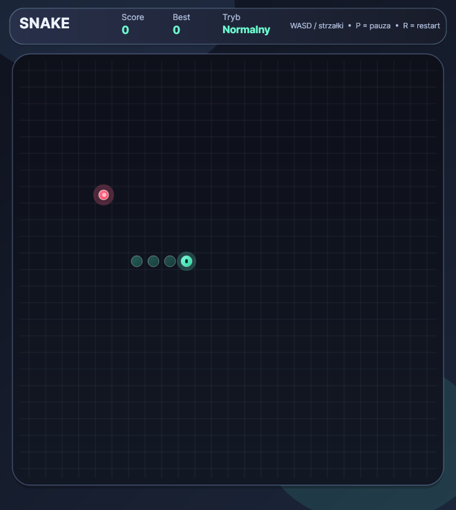

# Elegant Snake

[](https://github.com/Pawel123j/SNAKE/actions/workflows/ci.yml)

Klasyczny Snake w C# i Avalonia. Gra ma planszę 26×26, trzy poziomy trudności,
różne rodzaje jedzenia, przeszkody, tabelę wyników i ekran wygranej po zajęciu
ostatniego wolnego pola.



## Uruchomienie i sprawdzanie

Wymagany jest .NET 8 SDK.

```bash
dotnet run
dotnet test tests/SnakeGame.Tests/SnakeGame.Tests.csproj -c Release
dotnet build Snake.csproj -c Release
```

Okno można zmieniać rozmiarem; `Viewbox` skaluje planszę i HUD z zachowaniem
proporcji. Test GUI sprawdza też okno 400×450. Wyniki są zapisywane atomowo.

## Sterowanie

| Klawisze | Działanie |
|---|---|
| Strzałki / `WASD` | Ruch węża |
| `1` / `2` / `3` | Wybór poziomu w menu: łatwy / normalny / trudny |
| `Enter` / `Spacja` | Start lub nowa gra |
| `P` / `Esc` | Pauza / wznowienie |
| `R` | Restart |
| `M` | Ograniczenie animacji / przywrócenie animacji |

Na łatwym poziomie wąż przechodzi przez krawędzie. Trudny poziom dodaje
przeszkody. Jedzenie daje 5, 10 albo 30 punktów; zajęcie całej planszy kończy
grę stanem zwycięstwa.

## Zrzuty i demo

Zrzuty wykonano z działającego okna Linux X11/Xvfb. Obejmują jedzenie,
zakończenie gry, zapisany rekord po ponownym uruchomieniu oraz mniejsze okno.

| Obraz | Co pokazuje |
|---|---|
| [gameplay.png](docs/screenshots/gameplay.png) | Plansza w trakcie gry |
| [food-collected.png](docs/screenshots/food-collected.png) | Zebrane jedzenie i wynik 10 |
| [game-over.png](docs/screenshots/game-over.png) | Koniec gry i zapisany rekord |
| [best-score-after-restart.png](docs/screenshots/best-score-after-restart.png) | Rekord odczytany w nowym procesie |
| [small-window.png](docs/screenshots/small-window.png) | Widok w oknie 400×450 |

`scripts/smoke_gui.py` uruchamia prawdziwe okno i sprawdza wybór poziomu,
pauzę, wznowienie, restart oraz skalowanie. `scripts/scored_gui.py` prowadzi
węża do jedzenia, obserwuje wynik na planszy i sprawdza jego zapis po nowym
uruchomieniu.

## Zakres walidacji

Na Linuksie: 34 testy xUnit PASS, Release build bez ostrzeżeń, GUI smoke PASS
w X11/Xvfb oraz demo punktacji PASS. Demo uzyskało 10 punktów, a ponownie
uruchomiona gra pokazała zapisany rekord. To potwierdza tę ścieżkę na Linuksie;
Windows i macOS nie były uruchamiane w tej walidacji. Dźwięk jest
zaimplementowany tylko dla Windows i nie został tu sprawdzony.

## Struktura

- `SnakeGame.cs` — logika ruchu, kolizji, jedzenia i zwycięstwa.
- `GameControl.cs` / `GameRenderer.cs` — wejście, przebieg gry i rysowanie.
- `Scoreboard.cs` — odczyt i atomowy zapis wyników.
- `tests/SnakeGame.Tests/` — testy logiki i regresja pełnej planszy.
- `scripts/` — testy GUI sterujące uruchomioną aplikacją.

MIT — patrz [LICENSE](LICENSE).
